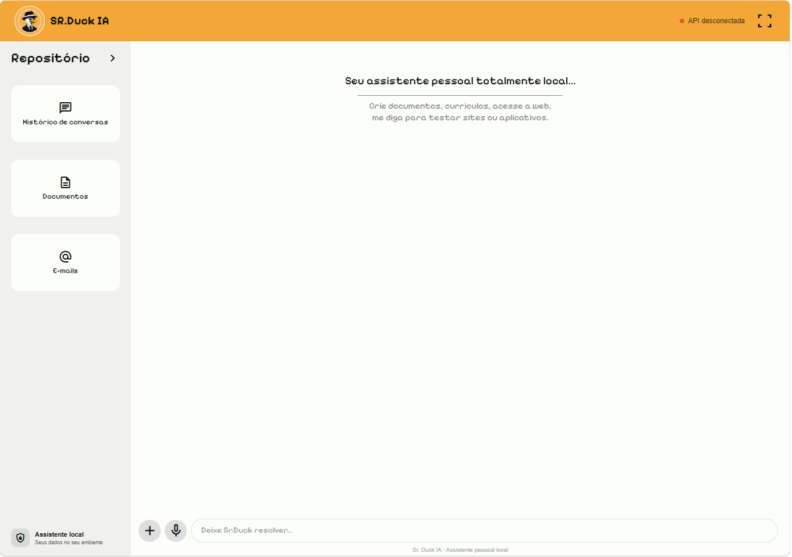
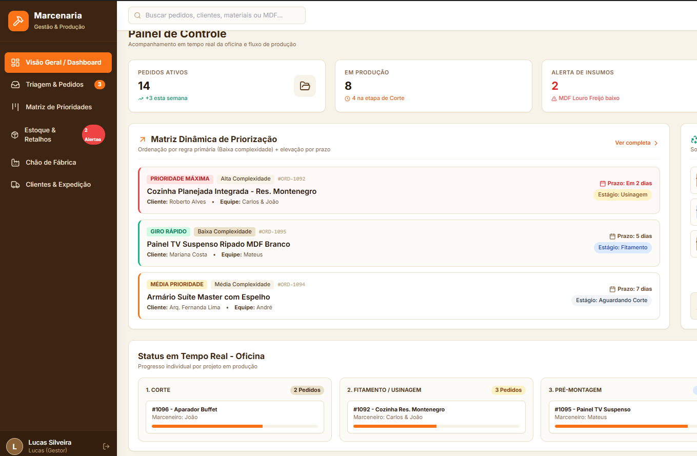

<h3>$\Huge{\color{#FF4500}{\textbf{Kauê Davi}}}$</h3>
<h3>
  $\large{\color{#00FFFF}{\text{» Desenvolvedor Back-end «}}}$ 
  $\large{\color{#00FFFF}{\text{» Analista/Cientista de Dados «}}}$
</h3>

 
 

**Sou um profissional que une desenvolvimento de software e Ciência de Dados para trazer soluções que vão além de códigos e planilhas isoladas! 🎢**

 

 

<h3>$\color{#FFD700}{\text{HABILIDADES}}$</h3>

<table align="center">
  <tr valign="top">
    <td width="33%">
      

        
         
        <b>🔥 PostgreSQL</b>
      

      <ul>
        <li>Modelagem de banco de dados</li>
        <li>Normalização</li>
        <li>JSONB</li>
        <li>JOIN, VIEW, GROUP BY, SUBQUERY, AS...</li>
      </ul>
    </td>
    <td width="33%">
      

        
         
        <b>✳ Node.js</b>
      

      <ul>
        <li>Express, pg & ORMs</li>
        <li>Consumo de APIs e bibliotecas</li>
        <li>Boas práticas e Documentação</li>
        <li>Manipulação de dados JSON</li>
        <li>Tratamento de erros</li>
      </ul>
    </td>
    <td width="33%">
      

        
         
        <b>🌌 Dados/IA</b>
      

      <ul>
        <li>Experiência em criação de agentes</li>
        <li>Conhecimento em engenharia de prompt</li>
        <li>Supervisão e controle de projeto</li>
        <li>Conhecimento de escopo</li>
        <li>Análise de dados e clientes</li>
      </ul>
    </td>
  </tr>
</table>

<h3>$\color{#00FFFF}{\text{✦ SEM ESCOPO...}}$</h3>

Combino minha capacidade analítica com domínio técnico para extrair, tratar e automatizar dados, além de criar soluções reais com o desenvolvimento de projetos.

 
 

<h2>$\Huge{\color{#FF4500}{\textbf{Projetos}}}$</h2>

<h3>$\color{#FFD700}{\text{Agente IA local: Sr.Duck IA}}$</h3>

**Descrição:** Agente de IA autônomo desenvolvido em Node.js (ES Modules) e alimentado por um LLM local (Ollama / qwen2.5-coder).

Arquitetura modular baseada em Tool Calling assíncrono, permitindo a execução segura de automações de sistema, scraping web, manipulação de arquivos e envio de e-mails (SMTP), com controle rígido de rotas e permissões HTTP RESTful.

<h3>$\color{#00FFFF}{\text{Portfólio real: Corretor de Imóveis}}$</h3>

**Descrição:** Projeto real envolvendo um cliente que buscava aumentar sua relevância digital. O resultado: um cliente satisfeito e muito agradecido.

Esse projeto demonstra minhas noções de UX/UI, Bootstrap, HTML e CSS, pois, além de criar APIs e gerir dados, também sei desenvolver interfaces! Criei uma Landing Page e cuidei de toda a parte de hospedagem, envio de mensagens via WhatsApp e registro de domínio!

<h3>$\color{#FFD700}{\text{Marcenaria (em desenvolvimento)}}$</h3>

**Descrição:** API RESTful desenvolvida em Node.js e Express para a gestão completa de insumos, ordens de serviço e catálogo de produtos de marcenaria. 

A aplicação destaca-se pela modelagem de dados híbrida no PostgreSQL, combinando tabelas relacionais com colunas JSONB (NoSQL) para suportar atributos e especificações técnicas dinâmicas sem perder a integridade referencial nem o desempenho das consultas.

 
 

<table align="center" border="0">
  <tr valign="top">
    <td width="33%">
      

        
          
        <b>DADOS</b>
      

    </td>
    <td width="33%">
      

        
          
        <b>BACK</b>
      

    </td>
    <td width="33%">
      

        
          
        <b>FRONT</b>
      

    </td>
  </tr>
</table>

 

<h1 align="center">Três coisas em um lugar!</h1>

Interessado? Entre em contato comigo: <a href="mailto:kauedavirochadev@gmail.com">kauedavirochadev@gmail.com</a>
